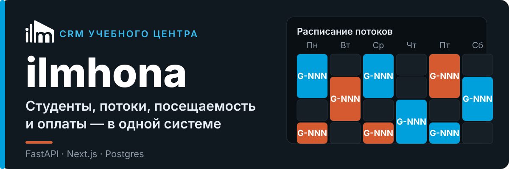
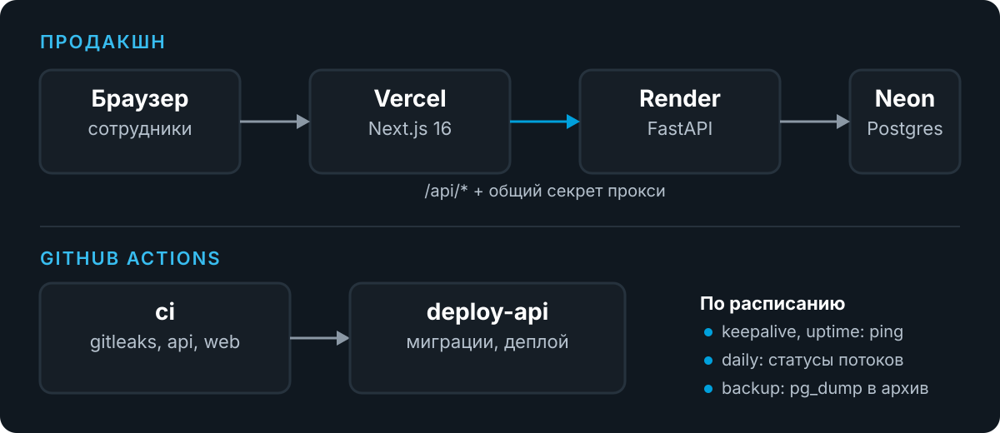

<p align="center">
  
</p>

CRM для учебного центра ilmhona (два филиала: Душанбе и Истаравшан). Один вход для сотрудников и инструкторов, права по ролям и журнал изменений. Техническое задание: [`docs/SPEC.md`](docs/SPEC.md).

## Что умеет

| Раздел | Для чего |
| --- | --- |
| Дашборд, мастер-лист | Сводные цифры по филиалам и потокам; все экраны берут числа из одного модуля `metrics` |
| Лиды, маркетинг | Воронка заявок, звонки, рекламные кампании |
| Студенты, потоки, аудитории | Зачисления, расписание уроков, аудитории без пересечений |
| Посещаемость и оценки | Отметка урока с телефона, шкалы оценок потока и академии |
| Оплаты | Оплаты по месяцам и способам, подтверждение |
| Инструкторы, зарплаты | Ставки, выплаты, личный кабинет «Сегодня» и «Мои выплаты» |
| Выпускники, трудоустройство | Статусы выпускников и места работы |
| Сертификаты | Конструктор шаблонов, PDF для выпускников |
| Пользователи, роли, журнал | Матрица прав по разделам и филиалам, временные пароли, аудит всех изменений |

Интерфейс только на русском, адаптирован под ПК и телефон, есть светлая и тёмная тема.

## Как устроено

<p align="center">
  
</p>

- `apps/web` — Next.js 16, React 19, HeroUI 2, Tailwind 4 (pnpm). Vercel проксирует `/api/*` в API и подставляет общий секрет.
- `apps/api` — FastAPI, SQLAlchemy 2 async, Alembic, Postgres 18 (Python 3.14, uv).
- Деплой на `main`: после зелёного `ci` workflow `deploy-api` ждёт фронт на Vercel, применяет миграции и выкатывает API на Render.
- По расписанию: `keepalive` и `uptime` проверяют `/api/health`, `daily` обновляет статусы потоков, `backup` делает зашифрованный `pg_dump` в приватное хранилище.

## Запуск локально

Нужны Docker, uv, pnpm, Node 24.

```sh
make up                       # Postgres on 127.0.0.1:55433
make migrate                  # tables + branches + system roles
(cd apps/api && uv run python -m app.cli create-superadmin --login admin)   # prints a temp password
make api                      # API on :8200   (docs: http://localhost:8200/api/docs)
(cd apps/web && pnpm install) && make web                                   # web on :3200
```

Откройте http://localhost:3200, войдите как `admin` с выведенным паролем и задайте свой.
Временный пароль показывается один раз и действует 7 дней.

Демо-данные (все имена выдуманные): `cd apps/api && uv run python -m app.cli seed-demo`, убрать — `wipe-demo`.

`make check` запускает линтеры, проверку типов и тесты обоих приложений (тестам API нужен `make up`; они используют отдельную базу `ilmhona_test`, поменять — `TEST_DB_NAME`, сервер — `DATABASE_URL`).

## Настройки (env)

`DATABASE_URL`, `JWT_SECRET`, `COOKIE_SECURE`, `ENV`, `PROXY_SHARED_SECRET` (одно значение в API и в веб-приложении; тогда API отклоняет запросы в обход прокси), `API_URL` для прокси веба.

`ENV=production` не запустится без надёжных `JWT_SECRET` и `PROXY_SHARED_SECRET` (32+ символа) и `COOKIE_SECURE=true`. Подробности: `apps/api/app/core/config.py`.

## Документация

- [`docs/SPEC.md`](docs/SPEC.md) — ТЗ: модель данных, права, метрики, этапы
- [`docs/ANALYSIS.md`](docs/ANALYSIS.md) — анализ старой системы и список багов
- [`docs/IMPORT.md`](docs/IMPORT.md) — перенос данных из старой системы
- [`docs/ops/deploy.md`](docs/ops/deploy.md), [`monitoring.md`](docs/ops/monitoring.md), [`restore-drill.md`](docs/ops/restore-drill.md) — деплой, мониторинг, восстановление
- [`docs/security/`](docs/security/) — отчёт о проверке безопасности
